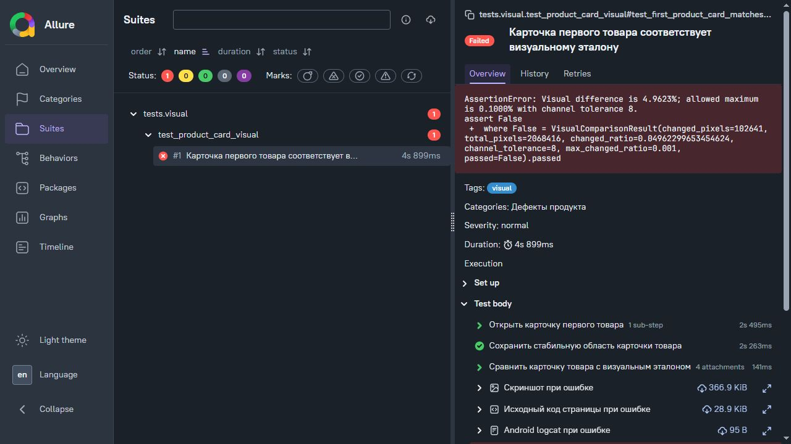
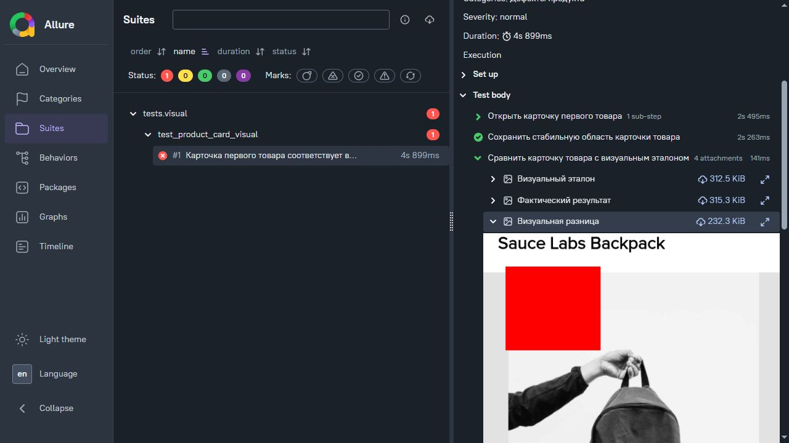

# Appium Android UI-тесты

[](https://www.python.org/)
[](https://pytest.org/)
[](https://appium.io/)
[](https://www.android.com/)
[](https://github.com/Yana-099/appium-android-tests/actions/workflows/android-self-hosted.yml)
[](https://yana-099.github.io/appium-android-tests/)

Портфолио-проект с автоматизированными UI-тестами Android-приложения [Sauce Labs My Demo App](https://github.com/saucelabs/my-demo-app-android).

Проект демонстрирует не просто набор UI-сценариев, а поддерживаемый фреймворк мобильной автоматизации на Python, pytest, Appium, Page Object Model и Allure.

## 1. Функциональная мобильная автоматизация

Проект проверяет ключевые бизнес-потоки демо-магазина: авторизацию, каталог и карточки товаров, корзину и оформление заказа. Тесты запускаются по одному файлу или по маркерам `smoke`, `regression`, `negative` и `visual`.

- Экранная логика и локаторы находятся в переиспользуемых классах Page Object.
- Проверки остаются в тестах, а данные централизованы в `config/test_data.py`.
- Один тестовый сценарий размещается в одном файле, тесты сгруппированы по бизнес-областям.
- Обычные `assert` останавливают критический сценарий в точке падения; soft assertions намеренно не используются.

Набор отобран по смыслу, а не по количеству тестов. Каждый сценарий показывает отдельное бизнес-покрытие или самостоятельную возможность автоматизации. Дублирующие и постоянно нестабильные проверки исключены, чтобы регулярные прогоны оставались сфокусированными и заслуживающими доверия.

## 2. Скриншот-тестирование (визуальный контроль)

Визуальный тест карточки товара контролирует изображение, название, цену, рейтинг, выбор цвета, управление количеством и кнопку `Add to cart`. Область скриншота не включает системные панели Android и временную полосу прокрутки.

Запуск визуального теста:

```powershell
pytest -m visual -v
```

Закоммиченный эталон поддерживает фиксированное окружение:

- устройство: `emulator-5554`;
- разрешение: `1080x2400`;
- ориентация: портретная;
- эталон: `tests/visual/baselines/android-emulator-5554/product_card.png`.

Pillow сравнивает RGB-изображения без изменения размера. Пиксель считается изменённым, если хотя бы один цветовой канал отличается более чем на `8`; тест падает, если изменённые пиксели занимают более `0.1%` захваченной области. Пороги откалиброваны на повторных запусках фиксированного профиля и требуют повторной калибровки для другого устройства или конфигурации Android.

Каждое сравнение добавляет в Allure четыре вложения:

- `Визуальный эталон` — закоммиченное эталонное изображение;
- `Фактический результат` — скриншот текущего прогона;
- `Визуальная разница` — изображение с расхождениями, выделенными красным;
- `Метрики визуального сравнения` — JSON с количеством изменённых пикселей, их долей, порогами и статусом проверки.

Если размеры изображений различаются, тест не масштабирует их. В Allure прикладываются оба исходных изображения, диагностическое изображение и структурированные сведения об ошибке. Эталоны не обновляются автоматически при обычном запуске.

### Пример падения в Allure

В отчёте видны причина падения, рассчитанная доля изменённых пикселей и диагностические вложения:



Открытый diff выделяет изменённую область красным:



## 3. Мультиустройства, ADB и Android lifecycle

Фреймворк поддерживает два профиля Android-эмуляторов с отдельными UDID, портами UiAutomator2, каталогами визуальных эталонов и результатами Allure:

| Профиль | Конфигурация | UDID | systemPort | Allure |
| --- | --- | --- | ---: | --- |
| `pixel_api31` | Pixel 6, профиль по умолчанию | `emulator-5554` | `8200` | `allure-results/` |
| `small_phone_api34` | Small Phone, Android 14 / API 34 | `emulator-5556` | `8201` | `allure-results-small_phone_api34/` |

PowerShell-скрипт проверяет доступность обоих эмуляторов через ADB, затем последовательно запускает на них один и тот же сценарий:

```powershell
.\tools\run_multi_device_demo.ps1
```

Путь или аргументы pytest можно переопределить:

```powershell
.\tools\run_multi_device_demo.ps1 -TestPath "-m smoke"
.\tools\run_multi_device_demo.ps1 -TestPath "tests/login/test_valid_login.py tests/products/test_product_card.py"
```

Скрипт выводит статус каждого профиля, UDID, `systemPort`, код завершения и каталог Allure. Он возвращает `exit 1`, если устройство не прошло pre-flight-проверку или тест завершился ошибкой. Параллельный запуск намеренно не реализован, чтобы демонстрация оставалась простой и предсказуемой.

Lifecycle-сценарии проверяют поведение приложения при системном `Back`, блокировке устройства, push-уведомлении и сохранении данных Checkout. Изолированная crash-демонстрация запускается только явно и не ломает обычные прогоны:

```powershell
pytest tests/lifecycle/test_crash_demo.py --run-crash-demo -v
```

## 4. Allure-отчётность и диагностика падений

Проект использует гибридный подход к Allure-шагам:

- повторно используемые UI-действия объявлены через `@allure.step` в Page Object;
- сценарные проверки, валидация форм, lifecycle-действия и `assert` остаются явными блоками `with allure.step(...)` в тестах.

Так технические детали не дублируются, а в отчёте сохраняются понятные бизнес-шаги. При падении теста фреймворк автоматически добавляет в Allure скриншот, XML page source и Android logcat. Для crash-демонстрации logcat фильтруется до релевантных сообщений о сбое приложения.

Pytest записывает сырые результаты в отдельный каталог выбранного профиля. Локальный отчёт для профиля по умолчанию открывается командой:

```powershell
allure serve allure-results
```

GitHub Actions запускает проверки на self-hosted runner, собирает Allure и публикует актуальный отчёт на [GitHub Pages](https://yana-099.github.io/appium-android-tests/).

## 5. AI-анализ падений

CLI-инструмент разбирает артефакты одного упавшего мобильного теста. Демонстрационный сценарий — негативная проверка неверного пароля: в зафиксированном падении screenshot и XML показывают экран Products, хотя проверка ожидала Login.

### Схема работы

```text
pytest
  → screenshot + page source + logcat в allure-results
  → tools/analyze_failure.py: сжатие XML и маскирование секретов
  → OpenAI Responses API (только при наличии OPENAI_API_KEY)
  → Markdown-вложение AI failure analysis у того же теста в Allure
```

Скрипт анализирует существующий `failed`/`broken` Allure result и не создаёт искусственных сбоев. Для выбранного сценария такой result появляется, если актуальная версия демо-приложения действительно принимает неверный пароль:

```powershell
pytest tests/login/test_invalid_authorization.py -v
```

Если тест пройдёт, скрипт сообщит, что упавший result не найден. Для запуска анализа передайте ключ через переменную окружения:

```powershell
$env:OPENAI_API_KEY = "<your-key>"
python tools/analyze_failure.py --results allure-results
```

Результат выводится в консоль, сохраняется в `artifacts/ai-report.md` и добавляется к тому же тесту в Allure как Markdown-вложение **AI failure analysis**.

```json
{
  "root_cause": "Тест ожидает экран Login, но приложение осталось на Products.",
  "evidence": "В XML нет элемента Login; screenshot показывает заголовок Products.",
  "suggested_fix": "Перед проверкой изолировать состояние приложения или явно перейти на LoginPage."
}
```

Screenshot отправляется по умолчанию. Если изображение может содержать реальные данные, отключите его:

```powershell
python tools/analyze_failure.py --results allure-results --no-screenshot
```

`AI_FAILURE_MODEL` при необходимости переопределяет модель; по умолчанию используется `gpt-4o-mini`.

### Отказоустойчивость и безопасность

- `password`, `token`, `api_key`, `authorization` и Bearer-токены маскируются до отправки в API.
- Запрос использует `store: false`; ключ читается только из `OPENAI_API_KEY` и не хранится в репозитории.
- Если ключ не настроен или API недоступен, скрипт не меняет статус pytest-теста и не завершает сборку ошибкой, а добавляет в Allure объяснение.

Это компактный MVP без CI-анализа, массовой обработки падений, дедупликации и автоматического редактирования Page Object или локаторов. AI-рекомендация всегда требует ревью человеком.

## Архитектура проекта

### Технологический стек

- Python 3
- pytest
- Appium Python Client
- UiAutomator2
- Android Emulator и ADB
- Allure Report
- Pillow
- OpenAI Responses API

### Структура

```text
config/     # Конфигурация Appium, capabilities и тестовые данные
pages/      # Классы Page Object
tests/      # Тестовые сценарии, сгруппированные по функциональности
utils/      # Вспомогательные функции для Android, Allure и screenshot
tools/      # CLI-утилиты, включая AI-анализ и multi-device demo
artifacts/  # Локальные артефакты падений (не коммитятся)
```

## Установка и запуск

Перед запуском необходимы Python 3, Android-эмулятор или устройство в ADB, запущенный Appium, установленное приложение Sauce Labs My Demo App и Allure CLI для просмотра отчётов.

Общая конфигурация находится в `config/settings.py`, профили устройств — в `config/device_profiles.py`:

- Appium: `http://127.0.0.1:4723`;
- application id: `com.saucelabs.mydemoapp.android`.

Установка зависимостей:

```powershell
python -m venv .venv
.\.venv\Scripts\Activate.ps1
pip install -r requirements.txt
```

Запуск одного файла:

```powershell
pytest tests/login/test_valid_login.py -v
```

Запуск по маркеру, например `smoke` (его можно заменить на `regression`, `negative` или `visual`):

```powershell
pytest -m smoke -v
```

Выбор профиля устройства:

```powershell
pytest -m smoke --device pixel_api31
pytest -m smoke --device small_phone_api34
```

Если `--device` не указан, используется `pixel_api31`. Для `small_phone_api34` требуется доступный `emulator-5556`.

## Безопасность и назначение проекта

Учётные данные и платёжные значения в `config/test_data.py` — публичные демонстрационные данные, а не персональные или боевые данные. Не добавляйте в репозиторий реальные секреты, токены или персональные данные.

Репозиторий предназначен для QA-портфолио по автоматизации. Локальные окружения, сгенерированные отчёты, скриншоты, логи и временные артефакты исключены из Git.
